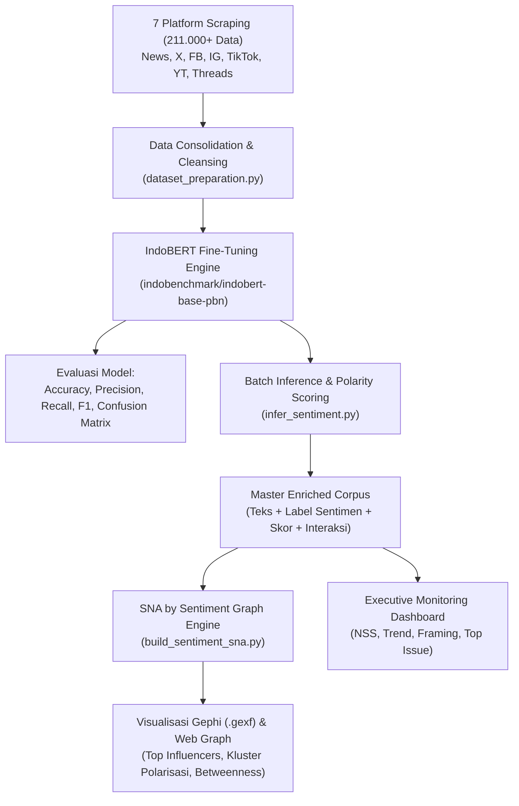

# 📘 PANDUAN LENGKAP TUGAS AKHIR (TA): INDOBERT & SOCIAL NETWORK ANALYSIS (SNA) BY SENTIMENT

> [!IMPORTANT]
> **Fokus Utama Penelitian**: *Marketing Tools & Social Network Analysis (SNA) by Sentiment Menggunakan Deep Learning IndoBERT untuk Analisis Persepsi Kebijakan Publik (Studi Kasus: MBG, KDMP, dan Sekolah Rakyat Menuju Pemilu 2029).*  
> **Benchmark Arsitektur**: Integrasi Metrik [Drone Emprit](https://pers.droneemprit.id/) & Standar Pemantauan Eksekutif **Kementerian Pekerjaan Umum Republik Indonesia**.

---

## DAFTAR ISI
1. [Arsitektur Sistem: Alur dari Scraping hingga SNA](#1-arsitektur-sistem)
2. [Panduan Lengkap Metrik Evaluasi Model Deep Learning](#2-panduan-evaluasi-model-deep-learning)
   - [Confusion Matrix Multi-Class](#21-confusion-matrix)
   - [Accuracy](#22-accuracy)
   - [Precision](#23-precision)
   - [Recall](#24-recall)
   - [F1-Score (Macro, Micro, Weighted)](#25-f1-score)
   - [Net Sentiment Score (NSS) ala Kementerian PU](#26-net-sentiment-score-nss)
   - [Uji Signifikansi Statistik (Z-Test & P-Value)](#27-uji-kebermaknaan-statistik)
3. [Panduan Pelatihan (Training & Fine-Tuning) IndoBERT](#3-panduan-training-indobert)
4. [Integrasi IndoBERT ke Graf SNA (*SNA by Sentiment*)](#4-integrasi-indobert-ke-sna)
5. [Struktur Laporan Monitoring Eksekutif Harian/Pekanan/Bulanan](#5-struktur-laporan-monitoring-eksekutif)
6. [Kunci Pembahasan untuk Sidang / Bimbingan dengan Pak Ihsan](#6-kunci-pembahasan-sidang-ta)

---

## 1. Arsitektur Sistem

Penelitian ini menghubungkan **Data Mining Multi-Platform**, **Deep Learning NLP (IndoBERT)**, dan **Graph Network Theory (SNA)**:



---

## 2. Panduan Evaluasi Model Deep Learning

Dalam sidang Tugas Akhir, dosen penguji akan menguji pemahaman matematis dan interpretasi Anda terhadap performa model klasifikasi 3 kelas (*Negatif: 0, Netral: 1, Positif: 2*).

### 2.1. Confusion Matrix
Confusion Matrix adalah tabel kontinjensi yang membandingkan **Label Aktual (Ground Truth)** dengan **Label Prediksi Model**.

Untuk 3 Kelas Sentimen ($3 \times 3$):
| | Prediksi Negatif | Prediksi Netral | Prediksi Positif |
| :--- | :---: | :---: | :---: |
| **Aktual Negatif** | **$C_{00}$ (True Negatif)** | $C_{01}$ (False Netral) | $C_{02}$ (False Positif) |
| **Aktual Netral** | $C_{10}$ (False Negatif) | **$C_{11}$ (True Netral)** | $C_{12}$ (False Positif) |
| **Aktual Positif** | $C_{20}$ (False Negatif) | $C_{21}$ (False Netral) | **$C_{22}$ (True Positif)** |

* **Diagonal Utama ($C_{00}, C_{11}, C_{22}$)**: Jumlah prediksi yang **BENAR**. Semakin tebal angka diagonal utama, semakin pintar model.
* **Di Luar Diagonal**: Jumlah kesalahan klasifikasi (*misclassification*).

---

### 2.2. Accuracy
Mengukur proporsi seluruh tebakan yang benar dari total data pengujian:

$$\text{Accuracy} = \frac{\sum_{i=0}^{2} C_{ii}}{\text{Total Data}} = \frac{C_{00} + C_{11} + C_{22}}{N}$$

* **Kelebihan**: Sangat mudah dipahami oleh masyarakat umum.
* **Kelemahan (*Accuracy Paradox*)**: Jika dataset Anda tidak seimbang (*imbalanced*, misal Netral 70%, Negatif 15%, Positif 15%), model yang hanya menebak Netral sepanjang waktu akan tetap mendapat akurasi 70%, padahal model tersebut gagal mendeteksi kritik publik. Oleh karena itu, **Accuracy TIDAK BOLEH berdiri sendiri tanpa Precision, Recall, dan F1-Score**.

---

### 2.3. Precision (Ketepatan)
Mengukur: *"Dari seluruh teks yang ditebak model sebagai sentimen X, berapa persen yang benar-benar sentimen X?"*

Untuk kelas $i$:
$$\text{Precision}_i = \frac{C_{ii}}{\sum_{j=0}^{2} C_{ji}} = \frac{\text{True Positive}_i}{\text{True Positive}_i + \text{False Positive}_i}$$

* **Signifikansi untuk Kebijakan Publik**:
  Jika model memiliki **Precision Negatif yang rendah**, artinya model sering salah menuduh postingan netral/positif sebagai kritik negatif (memicu alarm palsu / *false alarm* bagi tim monitoring pemerintah).

---

### 2.4. Recall (Sensitivitas / Jangkauan Tangkapan)
Mengukur: *"Dari seluruh data di dunia nyata yang sebenarnya bersentimen X, berapa persen yang berhasil ditemukan oleh model?"*

Untuk kelas $i$:
$$\text{Recall}_i = \frac{C_{ii}}{\sum_{j=0}^{2} C_{ij}} = \frac{\text{True Positive}_i}{\text{True Positive}_i + \text{False Negative}_i}$$

* **Signifikansi untuk Kebijakan Publik (Sangat Krusial!)**:
  Dalam pemantauan isu pemerintah (seperti keracunan makanan MBG atau mutu gedung Sekolah Rakyat ambrol), **Recall Negatif adalah metrik yang paling vital**. Jika Recall Negatif rendah, krisis sosial di masyarakat tidak terdeteksi oleh sistem (*missed crisis*), sehingga pimpinan terlambat merespons.

---

### 2.5. F1-Score (Harmonic Mean)
Rata-rata harmonik antara Precision dan Recall. F1-score memberikan hukuman berat jika salah satu antara Precision atau Recall bernilai sangat rendah:

$$F_1 = 2 \times \frac{\text{Precision} \times \text{Recall}}{\text{Precision} + \text{Recall}}$$

Untuk dataset multi-kelas, terdapat 3 varian perhitungan:
1. **Macro F1-Score (Paling Direkomendasikan untuk TA)**:
   Rata-rata aritmatika sederhana dari F1 tiap kelas tanpa memandang jumlah sampel:
   $$\text{Macro } F_1 = \frac{F_{1,\text{negatif}} + F_{1,\text{netral}} + F_{1,\text{positif}}}{3}$$
   *Sangat adil karena memberikan bobot yang sama untuk setiap kelas, membuktikan model adil terhadap kelas minoritas.*
2. **Weighted F1-Score**:
   Rata-rata F1-score yang dibobotkan berdasarkan proporsi jumlah data aktual tiap kelas.
3. **Micro F1-Score**:
   Dihitung secara global dari total TP, FP, dan FN (nilainya sama dengan Accuracy pada multi-class single-label).

---

### 2.6. Net Sentiment Score (NSS) ala Kementerian PU
Dalam slide monitoring Kementerian Pekerjaan Umum (Slide 1, 4, 5), performa nada institusi tidak diukur dengan persentase mentah, melainkan dengan **Net Sentiment**:

$$\text{NSS} = \frac{\text{Volume Positif} - \text{Volume Negatif}}{\text{Total Volume}} \times 100$$

* Rentang Skor: $-100$ s/d $+100$
  * $\text{NSS} > +40$: Kategori Sangat Aman / Citra Publik Sangat Positif.
  * $0 \le \text{NSS} \le +40$: Kategori Sedang / Waspada.
  * $\text{NSS} < 0$: Kategori Krisis / Sentimen Publik Negatif Mendominasi.

---

### 2.7. Uji Kebermaknaan Statistik (Z-Test & P-Value)
Seperti pada slide Kementerian PU (Slide 2, 7, 26), kenaikan/penurunan sentimen tidak boleh langsung disimpulkan membaik/memburuk sebelum diuji secara statistik:

$$Z = \frac{p_1 - p_2}{\sqrt{p(1-p)\left(\frac{1}{n_1} + \frac{1}{n_2}\right)}}$$

* Jika $|Z| \ge 1,96$ ($p < 0,05$ pada taraf signifikansi 95%): Perubahan dinyatakan **NYATA (Signifikan secara statistik)**.
* Jika $|Z| < 1,96$: Perubahan dinyatakan **DERAU (Noise / Kebetulan belaka)**.

---

## 3. Panduan Training IndoBERT

### 3.1. Spesifikasi Teknis
* **Base Model**: `indobenchmark/indobert-base-p1`
* **Architecture**: 12-layer Transformer, 768-hidden, 12-heads, 124M parameters.
* **Hyperparameters Terbaik untuk Teks Sosmed Indonesia**:
  * `Learning Rate`: $2 \times 10^{-5}$ ($0.00002$)
  * `Batch Size`: 16 (GPU 16GB) atau 32 (GPU 24GB+)
  * `Epochs`: 3 – 4 epoch (mencegah *catastrophic forgetting*)
  * `Optimizer`: AdamW ($\beta_1=0.9, \beta_2=0.999, \epsilon=10^{-8}$)
  * `Scheduler`: Linear Warmup (10% total training steps)
  * `Max Sequence Length`: 128 token (efisien dan mencakup 98% panjang postingan sosmed)

### 3.2. Cara Menjalankan di Google Colab (GPU T4 / A100 Gratis)
1. Buka Google Colab dan pastikan runtime diset ke **T4 GPU** (`Runtime -> Change runtime type -> T4 GPU`).
2. Install library pendukung:
   ```bash
   !pip install transformers torch scikit-learn matplotlib seaborn
   ```
3. Upload folder `models/` dan `data/`.
4. Jalankan script:
   ```bash
   python models/train_indobert.py
   ```
5. Model terbaik otomatis tersimpan di folder `models/best_indobert_sentiment/` beserta file `evaluation_metrics.json`.

---

## 4. Integrasi IndoBERT ke SNA (*SNA by Sentiment*)

SNA murni hanya menghitung siapa berbicara dengan siapa. Dengan menyuntikkan IndoBERT, Anda menciptakan **SNA by Sentiment**:

1. **Node Properties**:
   * Setiap akun (*user/channel/media*) memiliki atribut warna berdasarkan sentimen IndoBERT:
     * **Hijau**: Akun dominan bernada Positif (Pemberdayaan, apresiasi program).
     * **Merah**: Akun dominan bernada Negatif (Kritik anggaran, kasus keracunan, advokasi).
     * **Abu-abu**: Media berita atau akun informatif netral.
2. **Top Influencers (In-Degree Centrality)**:
   * Mengukur seberapa sering suatu akun di-mention, dikutip, atau di-repost oleh orang lain. Akun dengan In-Degree tertinggi adalah **Key Opinion Leader (KOL)**.
3. **Top Amplifiers / Buzzers (Out-Degree Centrality)**:
   * Mengukur seberapa agresif suatu akun melakukan mention dan penyebaran konten.
4. **Jembatan Informasi (Betweenness Centrality)**:
   * Mengukur akun yang menjadi penghubung antara kubu yang terpolarisasi.
5. **Community Detection (Algoritma Louvain)**:
   * Mengelompokkan komunitas secara otomatis. Dalam konteks politik 2029, algoritma ini memperlihatkan kluster pendukung pemerintah vs oposisi vs masyarakat sipil.
6. **Modularity Score**:
   * Indeks 0 s/d 1 yang mengukur tingkat polarisasi diskursus. Jika Modularity > 0,6, diskursus publik di media sosial berada dalam polarisasi tajam.

---

## 5. Struktur Laporan Monitoring Eksekutif

Mengikuti blueprint laporan monitoring Kementerian PU, laporan intelijen media Anda dibagi menjadi 3 Bab Utama:

1. **Chapter 1: The Overview (Tinjauan Lintas Kanal)**
   * Volume dan Tren Penyebutan Harian (15 Tarikh Terakhir).
   * Net Sentiment Score (NSS) Agregat dan per Platform.
   * Dual Word Cloud: **Buzz of Cloud** (berdasarkan frekuensi) vs **Word of Cloud** (berdasarkan jangkauan/reach).
   * Framing Analysis (Pendekatan Robert Entman): *Problem Definition, Causal Interpretation, Moral Evaluation, Treatment Recommendation*.
2. **Chapter 2: The Deep Dive (Analisis Mendalam)**
   * Pemetaan Isu Negatif vs Positif per Platform.
   * Analisis SWOT Persepsi Publik (Kekuatan Program vs Kerentanan Figur).
   * Butterfly Effect Report: Melacak rantai kaskade (Percikan -> Liputan Media -> Riak Percakapan -> Negatif Organik Hari ke-3).
   * Uses & Gratification: Mengidentifikasi motif audiens mengonsumsi isu (pemantauan, solidaritas, atau tuntutan demonstrasi).
3. **Chapter 3: The Action (Rekomendasi Taktis)**
   * Matriks Isu yang Perlu Diawasi (Bobot Kelembagaan vs Jangkauan).
   * Status Verifikasi Isu (Terverifikasi vs Belum Terverifikasi vs Daur Ulang).
   * 5 Rekomendasi Tindakan Strategis Berbasis Data Berangka.

---

## 6. Kunci Pembahasan Sidang TA

Saat presentasi di hadapan Pak Ihsan dan dewan penguji, soroti 4 keunggulan riset Anda:
1. **Bukan Sekadar Scraping Biasa**: Menggunakan arsitektur multi-platform (7 kanal) dengan *Contextual Co-occurrence filtering* yang membuang ribuan noise tanpa menghilangkan kritik tajam.
2. **Keunggulan IndoBERT dibanding Algoritma Klasik (Naïve Bayes/SVM)**: IndoBERT memahami semantik kontekstual, slang bahasa Indonesia, dan kata negasi berganda yang gagal dibaca oleh TF-IDF.
3. **Nilai Kebaruan (*Novelty*) SNA by Sentiment**: Menghubungkan Deep Learning NLP dengan Graph Network Theory untuk melihat peta kekuasaan opini dan polarisasi sosial politik.
4. **Actionable Policy Tool**: Hasilnya bukan sekadar grafik teoritis, melainkan sistem pemantauan berbasis indikator kepuasan publik (*Net Sentiment Score*) yang siap dipakai oleh pengambil kebijakan pemerintah maupun riset pasar pemilu 2029.
